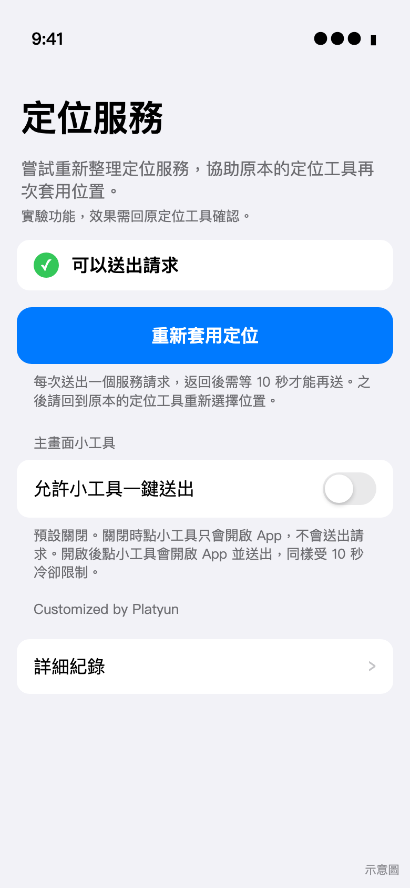
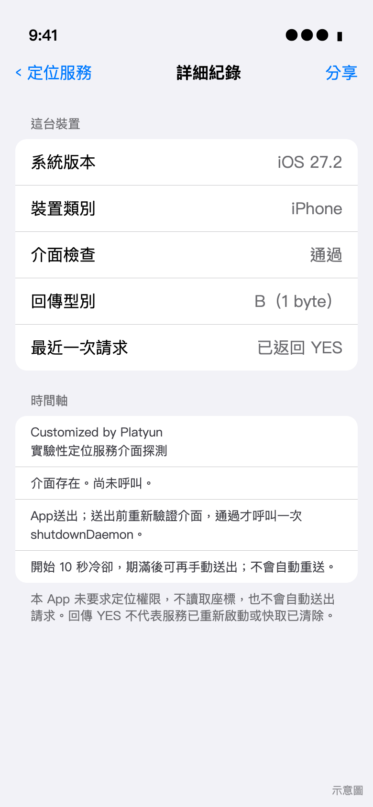
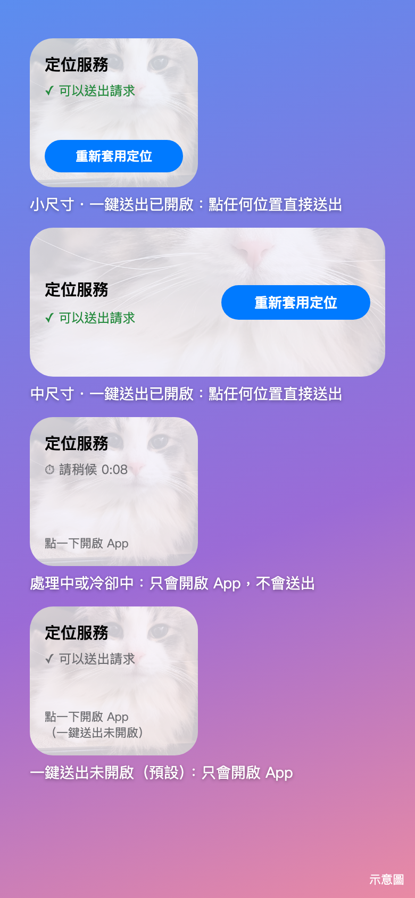

# 定位服務 App 操作手冊

Customized by Platyun

> 本手冊的畫面圖為**依 App 實際文字與版面繪製的示意圖**，不是真機截圖，實際外觀以你的裝置為準。

## 這個 App 做什麼

嘗試請 iPhone 重新整理定位服務，讓你原本使用的定位工具能再次套用位置。

**製作目的**：讓 iOS 27 在使用行動數據的情況下，也能重設定位資訊。

- 這是**實驗功能**。App 回報「請求已返回」只代表請求送出後系統有回應，**不代表**定位服務已重新啟動，也不代表任何快取已清除。
- 效果要回到你原本的定位工具重新選擇位置，才能確認。
- App 不要求定位權限、不讀取座標，也不會自動送出請求。

## 需求

- iPhone，iOS 27 或以上
- Mac 與 Xcode（支援 iOS 27.2 SDK）
- 你自己的 Apple 開發者簽署身分（免費帳號亦可）

## 安裝

1. 用 Xcode 開啟 `PlatyunLocationProbe.xcodeproj`。
2. 在 **PlatyunLocationProbe** 與 **PlatyunLocationWidget** 兩個 target 的 *Signing & Capabilities* 選你自己的 Team。
3. 接上 iPhone，選擇該裝置後按 Run。
4. 第一次啟動前，到 iPhone「設定 → 一般 → VPN 與裝置管理」信任你的開發者憑證。

### 簽署不接受 App Groups 時

小工具需要 App Groups 與 App 共用狀態。若你的簽署身分不支援：

1. 將 `Config/Local.xcconfig.no-app-groups.example` 複製為同資料夾的 `Local.xcconfig`。
2. 重新建置。

此時 App 仍正常運作，但小工具讀不到狀態，只會顯示「開啟 App 查看狀態」，點一下只會開啟 App。刪除 `Local.xcconfig` 即還原。

## 前置作業

下載 [`Platyun-location-block.conf`](../../download/Platyun-location-block.conf)（也包含在 `download/Platyun-Location-Download.zip`）→ 到 Shadowrocket 匯入此配置。

## 每次操作必要流程

**連接 Shadowrocket → 連接兩個藍牙 → 關閉定位 → ResetLocation → 開啟定位**

1. **連接 Shadowrocket**：選用已匯入的 `Platyun-location-block.conf`，開啟連線。
2. **連接兩個藍牙**：確認兩個藍牙連線都已完成。
3. **關閉定位**：在 iPhone 設定中關閉「定位服務」。
4. **ResetLocation**：開啟 App（顯示名稱為 `ResetLocation`），按「重新套用定位」，再按「送出請求」，等待「請求已返回」。已開啟一鍵送出時，也可以直接點主畫面小工具，不必開 App。
5. **開啟定位**：回到 iPhone 設定，重新開啟「定位服務」。

完成後回到原本的定位工具，確認位置是否套用。若請求未送出或未能完成，先查看詳細紀錄。

## App 畫面與操作

### 1. 首頁

- **狀態列**：顯示「正在檢查…」、「可以送出請求」或「目前無法使用此功能」。
- **重新套用定位**：狀態為「可以送出請求」時才能按。
- **允許小工具一鍵送出**：預設關閉，說明見下方「小工具」。
- **詳細紀錄**：查看裝置資訊、時間軸與小工具紀錄。

### 2. 送出請求

按下「重新套用定位」後，會先跳出確認框：

按「送出請求」才會真的送出，按「取消」則什麼都不會發生。

### 3. 請求返回

- 狀態變成「請求已返回」，按鈕顯示倒數「請稍候 N 秒」。
- 每次請求返回後需等 **10 秒**才能再送，不會自動重送。
- 依上方必要流程重新開啟「定位服務」，再回到原本的定位工具確認位置是否套用。

若顯示「請求未送出」或「未能完成請求」，代表送出前的檢查未通過或發生例外，請查看詳細紀錄。

### 4. 詳細紀錄

- **這台裝置**：系統版本、裝置類別、介面檢查結果、回傳型別、最近一次請求。
- **時間軸**：每個動作的紀錄，包含被拒絕的請求與原因。
- **小工具紀錄**：從小工具送出的每次結果（最新的在最上面），最多保留 50 筆。
- 右上角可分享紀錄，回報問題時很有用。

注意：若 App 在送出後被系統關閉，該次結果無法記錄。冷卻與小工具共用，強制結束 App 不會重置，手機重新開機後才會重置。

## 主畫面小工具

在主畫面長按空白處 → 左上角「＋」→ 搜尋「定位服務」或「ResetLocation」→ 選擇小（方形）或中（橫長方形）尺寸 → 加入小工具。小工具背景會淡淡顯示 App 圖示。

| 狀態 | 小工具表現 |
| --- | --- |
| 一鍵送出已開啟、可送出 | 顯示「重新套用定位」，點小工具任何位置都會**直接在背景送出**，不開啟 App，也不顯示確認框 |
| 處理中或冷卻中 | 顯示倒數，點一下只會開啟 App，不會送出 |
| 一鍵送出未開啟（預設） | 點一下只會開啟 App，不會送出任何請求 |

要使用一鍵送出，需先在 App 首頁開啟「允許小工具一鍵送出」，並確認開啟時的說明。App 與小工具共用同一個 10 秒冷卻，任一邊送出後兩邊都要等冷卻結束。小工具送出的結果可在 App「詳細紀錄 → 小工具紀錄」查看。

## 常見問題

**狀態顯示「目前無法使用此功能」？**
送出前的介面檢查未通過，通常是系統版本與 App 預期不符。到「詳細紀錄 → 介面檢查」查看原因。

**回傳 YES，但定位沒有改變？**
這是預期內可能發生的結果。回傳 YES 不代表效果成立，請回定位工具重新選擇位置再確認。

**按鈕一直是灰的？**
可能在檢查中、處理中，或處於 10 秒冷卻（可能是剛從小工具送出）。等待狀態更新即可。

**一直顯示「處理中」不會結束？**
送出途中程式可能被系統結束。為避免重複送出，無法確認時會保持處理中；重新開機即可恢復。

**按鈕顯示「冷卻紀錄無法使用」？**
App 與小工具共用的冷卻檔案無法讀寫，為安全起見不會送出。請確認 App Groups 設定，或重新安裝。

**小工具只顯示「開啟 App 查看狀態」？**
App Groups 未生效，見上方「簽署不接受 App Groups 時」。

## 已知限制

- 實際效果僅能由使用者在自己的裝置上驗證，本 App 不保證任何結果。
- 不同 iOS 版本的行為可能不同。
