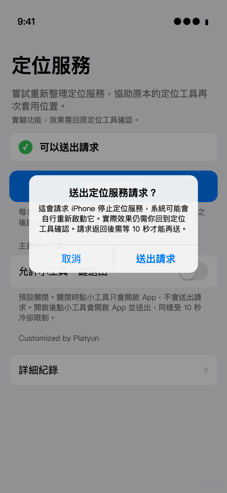
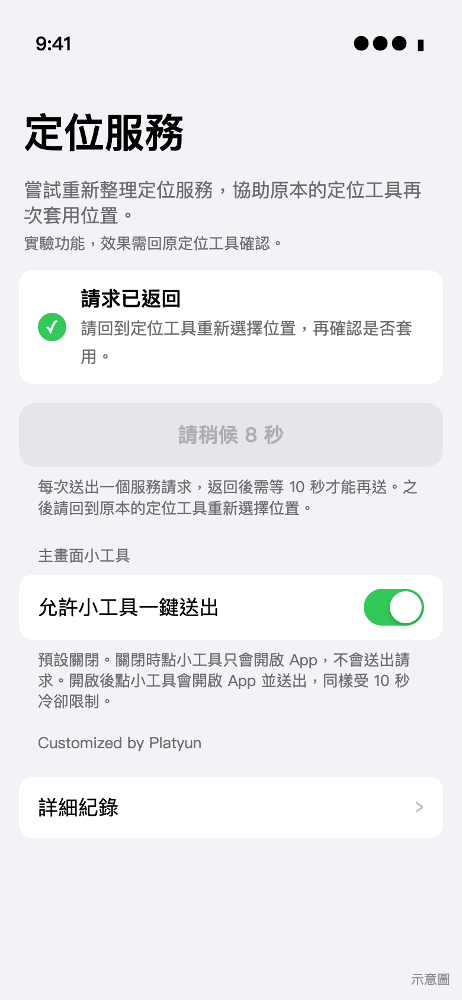

# 定位服務 App 操作手冊

Customized by Platyun

> 畫面圖是依 App 實際文字與版面繪製的示意圖, 不是真機截圖.

## 這個 App 做什麼

在 iOS 27 使用行動數據時, 嘗試讓 iPhone 重新整理定位服務, 讓你的定位工具能再次套用位置.

- 這是**實驗功能**. App 顯示「請求已返回」只代表系統有回應, **不代表**定位服務已重新啟動, 也不代表任何快取已清除.
- 有沒有效, 要照下方流程選完位置後用 Google 地圖確認.
- App 不要求定位權限, 不讀取座標, 也不會自動送出請求.

## 什麼時候要做

用定位工具選好的位置**跳回真實位置**時, 照「[每次操作流程](#每次操作流程)」做一次. 位置正常時不用做.

第一次安裝時若有重開 iPhone (例如開啟開發者模式), 先照常使用, 等位置跳回真實位置時再做.

## 第一次設定

以下只要做一次.

### 1. 安裝 App

沒有 Mac 的話, 用 IPA 側載安裝, 見 [側載安裝說明](../../download/側載安裝說明.md). 以下是 Mac + Xcode 的安裝步驟.

需要: iPhone (iOS 27 以上), Mac 與 Xcode (支援 iOS 27.2 SDK), 你自己的 Apple 帳號 (免費帳號也可以).

1. 在 Mac 用 Xcode 開啟 `PlatyunLocationProbe.xcodeproj`.
2. 左側點最上方的專案 → TARGETS 選 **PlatyunLocationProbe** → 上方分頁點 **Signing & Capabilities** → **Team** 選你的 Apple 帳號.
   完成: 這個分頁沒有紅色錯誤.
3. TARGETS 改選 **PlatyunLocationWidget**, 同樣在 **Team** 選你的 Apple 帳號.
   Bundle Identifier 與 App Group 會依你選的 Team 自動產生, 不用手動修改.
4. 用 USB 連接 iPhone 並解鎖. iPhone 跳出「要信任這部電腦嗎?」時按「信任」.
5. Xcode 視窗上方的裝置選單選你的 iPhone, 按左上角的 **Run** 按鈕.
6. 第一次安裝時, Xcode 會提示 iPhone 要開啟開發者模式:
   1. iPhone 到「設定 → 隱私權與安全性 → 開發者模式」, 打開開關, 按「重新啟動」.
   2. 重開後解鎖, 跳出開啟開發者模式的提示時按「開啟」, 輸入密碼.
   3. 回到 Xcode 再按一次 **Run**.
7. 打開 App 時若顯示「不受信任的開發者」: 到「設定 → 一般 → VPN 與裝置管理」, 點你的 Apple 帳號, 按「信任」.

完成: 主畫面出現 **ResetLocation**, 打開後狀態顯示「可以送出請求」.

免費 Apple 帳號的簽名約 7 天到期, 到期後 App 會打不開. 接上 Mac, 用 Xcode 再按一次 **Run** 即可.

#### Xcode 出現 App Groups 錯誤時

小工具要靠 App Groups 跟 App 共用狀態. 若你的帳號無法使用 App Groups:

1. 把 `Config/Local.xcconfig.no-app-groups.example` 複製一份, 放在同一個資料夾, 改名為 `Local.xcconfig`.
2. 回到 Xcode 再按一次 **Run**.

這樣 App 仍可正常使用, 但小工具讀不到狀態, 只會顯示「開啟 App 查看狀態」, 點一下只會開啟 App. 刪除 `Local.xcconfig` 即還原.

### 2. 匯入 Shadowrocket 配置

1. iPhone 打開 Shadowrocket, 點下方的「配置」.
2. 點右上角的「+」, 貼上以下網址, 按「下載」:
   ```
   https://raw.githubusercontent.com/Platyun/reset.loacation.by.Platyun/main/download/Platyun-location-block.conf
   ```
   完成: 「遠程文件」裡出現 `Platyun-location-block.conf`.
3. 點這個配置, 選「使用配置」.
   完成: 這個配置被標示為使用中.
4. 點下方的「首頁」, 「全局路由」選「配置」.

配置檔也可以直接下載: [`Platyun-location-block.conf`](../../download/Platyun-location-block.conf), 或在 [`Platyun-Location-Download.zip`](../../download/Platyun-Location-Download.zip) 裡.

### 3. 加入主畫面小工具 (可不做)

見下方「[主畫面小工具](#主畫面小工具)」.

## 每次操作流程

**Shadowrocket 連線 → 連接兩個藍牙 → 關閉定位服務 → ResetLocation → 開啟定位服務 → 定位工具選位置 → Google 地圖確認**

1. **Shadowrocket 連線**: 打開 Shadowrocket, 確認使用中的配置是 `Platyun-location-block.conf`, 打開「首頁」最上方的連線開關.
   完成: iPhone 狀態列出現「VPN」.
2. **連接兩個藍牙**.
   完成: 兩個藍牙都顯示已連線.
3. **關閉定位服務**: 到「設定 → 隱私權與安全性 → 定位服務」, 關閉最上方的「定位服務」開關, 跳出確認時按「關閉」.
   完成: 開關變成灰色.
4. **ResetLocation**: 打開 ResetLocation, 狀態顯示「可以送出請求」後按「重新套用定位」, 確認框再按「送出請求」.
   完成: 狀態變成「請求已返回」.
   已開啟小工具一鍵送出時, 也可以直接點主畫面小工具, 不必開 App.
5. **開啟定位服務**: 回到「設定 → 隱私權與安全性 → 定位服務」, 打開「定位服務」開關.
   完成: 開關變成綠色.
6. **選位置**: 在你使用的定位工具選擇要的位置.
7. **確認位置**: 打開 Google 地圖, 點定位按鈕.
   完成: 藍點在你選的位置.
   不要用 iPhone 內建的「地圖」App 確認, 會被擋.

藍點還在真實位置: 本 App 不保證有效, 這是可能的結果. 回報時到 App「詳細紀錄」右上角分享紀錄一起附上.

第 4 步顯示「請求未送出」或「未能完成請求」: 送出前的檢查沒通過或發生例外, 到「詳細紀錄」查看原因.

## App 畫面與操作

### 1. 首頁


- **狀態列**: 顯示「正在檢查…」, 「可以送出請求」或「目前無法使用此功能」.
- **重新套用定位**: 狀態為「可以送出請求」時才能按.
- **允許小工具一鍵送出**: 預設關閉, 見「[主畫面小工具](#主畫面小工具)」.
- **詳細紀錄**: 查看裝置資訊, 時間軸與小工具紀錄.

### 2. 送出請求

按「重新套用定位」後會跳出確認框:



按「送出請求」才會真的送出. 按「取消」什麼都不會發生.

### 3. 請求返回



- 狀態變成「請求已返回」, 按鈕顯示倒數「請稍候 N 秒」.
- 每次請求返回後要等 **10 秒**才能再送, 不會自動重送.
- 接著做「每次操作流程」第 5 步.

### 4. 詳細紀錄


- **這台裝置**: 系統版本, 裝置類別, 介面檢查結果, 回傳型別, 最近一次請求.
- **時間軸**: 每個動作的紀錄, 包含被拒絕的請求與原因.
- **小工具紀錄**: 從小工具送出的每次結果, 最新的在最上面, 最多保留 50 筆.
- 右上角可以分享紀錄, 回報問題時附上.

注意:

- App 在送出後被系統關閉的話, 這次結果無法記錄.
- App 與小工具共用 10 秒冷卻. 有 App Groups 時, 強制結束 App 不會重置冷卻, 重開 iPhone 才會重置.
- 用「[App Groups 錯誤時](#xcode-出現-app-groups-錯誤時)」的設定安裝時, 冷卻不會保存, 強制結束 App 就會重置.

## 主畫面小工具

### 加入小工具

1. 在主畫面長按空白處, 直到圖示開始晃動.
2. 點左上角「編輯」→「加入小工具」.
3. 搜尋「定位服務」或「ResetLocation」.
4. 選小 (方形) 或中 (橫長方形) 尺寸, 按「加入小工具」.

完成: 主畫面出現標題為「定位服務」的小工具, 背景淡淡顯示 App 圖示.


### 開啟一鍵送出

1. 打開 ResetLocation, 在首頁打開「允許小工具一鍵送出」.
2. 跳出確認框時按「開啟」.

完成: 小工具出現「重新套用定位」按鈕.

### 小工具顯示的狀態

| 小工具顯示 | 點一下會怎樣 |
| --- | --- |
| 「可以送出請求」或「請求已返回, 可再送出」, 加上「重新套用定位」按鈕 | **直接在背景送出**, 不開 App, 不顯示確認框. 只有開啟一鍵送出時才會出現這個按鈕 |
| 「可以送出請求」, 下方寫「點一下開啟 App (一鍵送出未開啟)」 | 只開啟 App, 不送出 |
| 「正在送出請求…」 | 只開啟 App, 不送出 |
| 「請稍候」加倒數 | 冷卻中, 只開啟 App, 不送出 |
| 「開啟 App 查看結果」 | 上次送出的結果無法確認, 開啟 App 查看 |
| 「目前無法使用」 | 只開啟 App, 原因見「詳細紀錄」 |
| 「開啟 App 查看狀態」 | 只開啟 App. 一直顯示這個時, 見常見問題 |

App 與小工具共用同一個 10 秒冷卻, 任一邊送出後, 兩邊都要等冷卻結束. 小工具送出的結果在 App「詳細紀錄 → 小工具紀錄」查看.

## 常見問題

**狀態顯示「目前無法使用此功能」?**
送出前的介面檢查沒通過, 通常是系統版本與 App 預期不符. 到「詳細紀錄 → 介面檢查」查看原因.

**回傳 YES, 但定位沒有改變?**
這是可能發生的結果. 回傳 YES 不代表有效. 照流程在定位工具重新選位置, 再用 Google 地圖確認.

**按鈕一直是灰的?**
可能在檢查中, 處理中, 或在 10 秒冷卻 (可能剛從小工具送出). 等狀態更新即可.

**一直顯示「處理中」不會結束?**
送出途中程式可能被系統結束. 為了避免重複送出, 無法確認時會保持處理中. 重開 iPhone 即可恢復.

**按鈕顯示「冷卻紀錄無法使用」?**
App 與小工具共用的冷卻檔案無法讀寫, 為了安全不會送出. 請確認 App Groups 設定, 或重新安裝.

**小工具一直只顯示「開啟 App 查看狀態」?**
先打開一次 App. 還是一樣的話, 代表 App Groups 沒有生效, 見「[Xcode 出現 App Groups 錯誤時](#xcode-出現-app-groups-錯誤時)」.

## 已知限制

- 實際效果只能由使用者在自己的裝置上驗證, 本 App 不保證任何結果.
- 不同 iOS 版本的行為可能不同.
